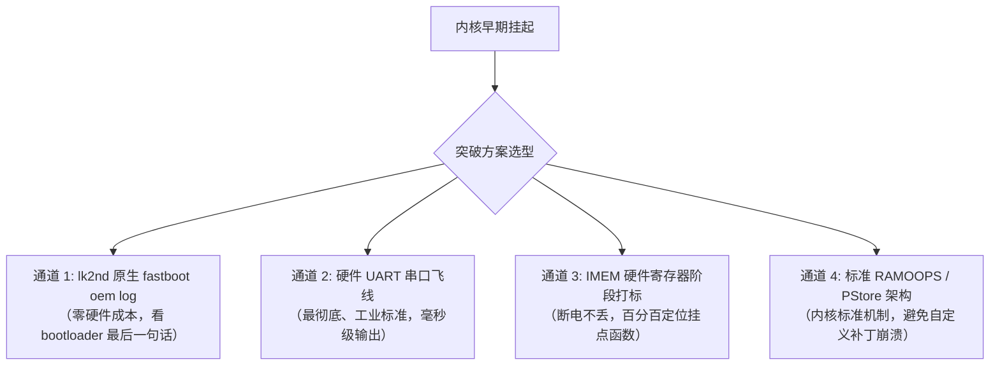
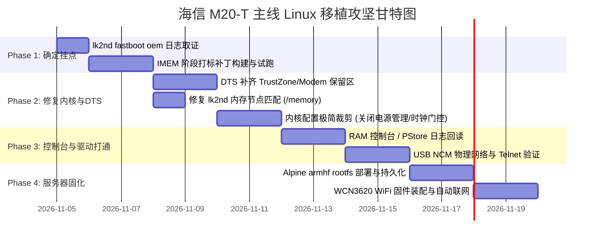

# M20-T 主线 Linux 移植攻坚蓝图与实施方案 (Master Plan: Booting Mainline Linux on Hisense M20-T)

> **版本**：v1.0 (2026-11-04)  
> **目标**：突破当前"进入 Linux 早期挂起（Early Hang）"的核心阻塞，建立可见性调试链路，打通内核引导，最终实现开机免按键自动进入 Alpine armhf 无头服务器（USB NCM / SSH / WiFi）。  
> **文档性质**：全景技术方案与分阶段实施规划（规划文档，暂不执行实机写操作）。

---

## 目录
1. [项目全景与当前基线状态（Baseline Status）](#1-项目全景与当前基线状态)
2. [核心瓶颈定位：主线内核早期挂起深度剖析（Root Cause Analysis）](#2-核心瓶颈定位主线内核早期挂起深度剖析)
3. [四大可见性突破手段（Diagnostic & Visibility Strategy）](#3-四大可见性突破手段)
4. [分阶段详细规划与实施路径（Execution Roadmap）](#4-分阶段详细规划与实施路径)
   - [Phase 1: 突破黑匣子——精准定态挂起分界线（0-3天）](#phase-1-突破黑匣子精准定态挂起分界线)
   - [Phase 2: 修复内核与设备树致命缺陷（3-7天）](#phase-2-修复内核与设备树致命缺陷)
   - [Phase 3: 最小系统与网络控制台打通（7-10天）](#phase-3-最小系统与网络控制台打通)
   - [Phase 4: 无头 Linux 服务器固化与持久化（10-14天）](#phase-4-无头-linux-服务器固化与持久化)
5. [备选路径与兜底预案（Contingency & Fallback Plans）](#5-备选路径与兜底预案)
6. [技术风险清单与避坑指南（Risk Registry & Hard Lessons）](#6-技术风险清单与避坑指南)

---

## 1. 项目全景与当前基线状态

### 1.1 设备硬件参数（实测确证）
- **机型**：海信 M20-T（Uniscope ODM 代工）
- **SoC**：Qualcomm MSM8909（骁龙 210/212，4× Cortex-A7 @ 1.1GHz，ARMv7 32 位）
- **PMIC**：PM8909
- **内存 (RAM)**：1GB LPDDR3（物理基地址 `0x80000000`，有效范围 `0x80000000 - 0xbfffffff`）
- **存储 (eMMC)**：7.4GB（GPT 分区表已完全取证提取）
- **网络子系统**：WCN3620（Pronto v3 PIL，主线驱动 `wcn36xx` 支持）
- **安全状态**：**无 Secure Boot 熔丝锁定**（无签名镜像实测可被 SBL1/aboot 引导）

### 1.2 现存已打通的资产（已完成里程碑）
1. **多重启动菜单与双阶段引导链**：
   - `PBL` -> `SBL1` -> `RPM/TZ` -> `stock aboot` -> `boot@0 (lk2nd-m20t-fix5)`。
   - lk2nd 菜单全链路打通：支持 **Reboot / Android / Linux / Bootloader / EDL / Shutdown**。
   - 30 秒倒计时无操作默认进入 Android，开机免按键进系统；无线 ADB 自动启动（端口 5555）。
2. **EDL 9008 救砖与底层刷写**：
   - 配合 loader `msm8909_ul40.mbn`，Mac 本地 Python 环境下直接刷写/备份 eMMC 分区。
   - 分区全量原始备份存在 `private/forensics/2026-10-29/`。
3. **CI/CD 构建流水线**：
   - GitHub Actions 云端构建 Linux 7.0 树内核与 lk2nd，无需本地污染 ARM 编译工具链。
4. **快速试跑验证通道**：
   - 手机在 lk2nd fastboot 下，可通过 `fastboot boot <boot.img>` 内存试跑，崩溃自动超时复位回到 lk2nd fastboot，不损坏 MMC。

### 1.3 唯二未解决的核心阻塞
- **阻塞 1（致命）**：主线内核启动瞬间进入**早期挂起（Early Hang）**，屏幕无显示、USB 物理枚举无反应，~10 秒后触发看门狗硬件复位（WDT Reset）。
- **阻塞 2（盲飞）**：缺乏有效终端输出（无 UART 硬件连线，且此前内存黑匣子提取为空），目前定位缺乏直接错误栈回溯。

---

## 2. 核心瓶颈定位：主线内核早期挂起深度剖析

根据内核启动流程与 MSM8909 SoC 架构，内核从跳转到挂死之间会经过四个关键层级。经代码反汇编与架构审计，目前存在 **5 个高概率致死点**：

```
[ lk2nd boot_linux ]
        │
        ▼ (R0=0, R1=machtype, R2=tags_phys=0x82500000)
[ zImage head.S ]  ──▶ 疑点 1: 解压重定位覆盖 / FDT 校验失败
        │
        ▼ (decompress_kernel: GZIP/XZ)
[ Kernel head.S ]  ──▶ 疑点 2: DEBUG_LL 临时页表缺页 / 强序内存对齐异常
        │
        ▼ (__turn_mmu_on -> __mmap_switched)
[ start_kernel() ] ──▶ 疑点 3: TrustZone/Modem 内存未保护触碰 XPU 硬件熔断
        │
        ▼ (setup_arch() -> early_init_fdt)
[ 设备驱动探测 ]   ──▶ 疑点 4: lk2nd /memory 节点名严格匹配死锁
                   ──▶ 疑点 5: SMD-RPM 时钟锁死 / 未知中断挂起
```

### 2.1 疑点 1：lk2nd `update_device_tree` 的 `/memory` 严格命名断言（高置信度）
- **机理**：查看 `sources/lk2nd/platform/msm_shared/dev_tree.c:2261`：
  ```c
  ret = fdt_path_offset(fdt, "/memory");
  if (ret < 0) {
      dprintf(CRITICAL, "Could not find memory node.\n");
      return ret;
  }
  ```
  在 `aboot.c` 中：
  ```c
  ret = update_device_tree(...);
  if (ret) {
      dprintf(CRITICAL, "ERROR: Updating Device Tree Failed\n");
      ASSERT(0);
  }
  ```
- **后果**：主线 Linux 设备树规范均写为 `memory@80000000`。若使用的 DTB 只有 `memory@80000000`，lk2nd 直接进入 `ASSERT(0)` 死循环或死机，**内核根本从未被执行过**！此前测试的 `zu02-dw01` 与 `nokia-leo` 原生 DTB 均无裸 `/memory` 节点。

### 2.2 疑点 2：TrustZone / Modem 内存保护单元 (XPU) 违规触发硬件下电（极高置信度）
- **机理**：从原厂 `dtb17-original.fdt` 逆向可知，MSM8909 在 DDR 空间中硬性切分了以下由高通 Secure World (TrustZone) 监控的专用内存段：
  - `0x86000000 - 0x87c00000`：TrustZone / QSEE 运行区
  - `0x87c00000 - 0x88000000`：External Image 引导区
  - `0x88000000 - 0x8c100000`：Modem / ADSP 运行区（整整 65MB！）
  - `0x8c100000 - 0x8c600000`：Peripheral 子系统保留区
- **后果**：主线内核启动时，`memblock` 默认扫描设备树。如果设备树中**没有明确声明这些 reserved-memory**（或者没有打上 `no-map`），Linux 内核初始化物理页时会向 `0x88000000` 等区域写入初始化数据或清零。一旦 ARM Cortex-A7 内核非安全世界（Non-Secure World）触碰 TrustZone 保护的 DDR 地址，SoC 的硬件 XPU 防火墙会**立刻产生硬件总线挂起（AXI Bus Fault）并直接重置芯片**！这种崩溃连任何内核 printk 都来不及打印。

### 2.3 疑点 3：DEBUG_LL 与 ROM 控制台补丁本身的副作用引发内核崩溃
- **机理**：
  1. `kernel-romconsole.patch` 把 `msm.S` 的 `waituarttxrdy` 设为空，但 `senduart` 依然是 `str \rd, [\rx, #0x00]`。在虚拟地址映射后，它持续向 `0xcf001000` 写入单个字节，并未累加写指针。
  2. `head.S` 中建立 `DEBUG_LL` 临时映射时，该段内存被标记为 Device/Strongly-Ordered 内存。ARMv7 对 Strongly-Ordered 内存的非对齐访存（Unaligned Access）会直接触发硬件 Data Abort 异常。
  3. 当内核执行到 `paging_init()` 时，`head.S` 的临时页表被销毁，而 `0xcf001000` 并未在内核持久映射（Fixmap 或 Ioremap）中声明。此时一旦触发任何 printk，内核访问不存在的虚拟地址立即崩溃！

### 2.4 疑点 4：内存解压覆盖（Relocation Hazard）
- **机理**：
  lk2nd 配置的加载地址为：
  - Kernel (zImage): `0x80008000`
  - Tags (DTB): `0x82500000` (约 37MB 处)
  - Ramdisk (initramfs): `0x82700000` (约 39MB 处)
  zImage 解压后体积通常达到 15MB~25MB。zImage 在执行自解压时，会检测目标解压地址（`ZRELADDR = 0x80008000`）。若判断与自身体积重叠，zImage 会将自身向高地址搬移。若搬移的目标高地址与 `0x82500000`（DTB）冲突，解压代码会瞬间将 DTB 覆写，后续解压完成跳转内核时，内核读取不到合法的 Device Tree，直接卡死在 `setup_machine_fdt`。

---

## 3. 四大可见性突破手段（Diagnostic & Visibility Strategy）

要想彻底摆脱"试错 5 亿 token"的泥潭，必须将内核启动过程由"完全黑盒"变为"透明可见"。以下设计 4 个梯级的可见性通道：



### 3.1 通道 1：lk2nd 运行日志取证（`fastboot oem log`）
- **原理**：lk2nd 在编译时开启了 `WITH_DEBUG_LOG_BUF=1`。当执行 `fastboot boot <image>` 时，若在 lk2nd 内部发生任何错误（如 QCDT 匹配失败、`/memory` 节点未找到 `ASSERT(0)`、DTB 内存越界等），它在死前一定会向内部缓冲区记录信息。
- **动作**：试跑内核挂起回到 fastboot 后，立刻执行：
  ```bash
  fastboot oem log > lk2nd-boot.log
  ```
  直接检查 lk2nd 是否输出了 `Could not find memory node` 或 `booting linux @ ...`。

### 3.2 通道 2：硬件 UART 串口调试（强烈推荐，决定性手段）
- **原理**：高通 MSM8909 芯片提供 BLSP1_UART1 原生调试串口（115200 8N1）。
- **引脚定位**：
  - 根据 `dtb17`，`blsp_uart1` 引脚通常对应 MSM8909 GPIO 4 (TXD) 与 GPIO 5 (RXD)。
  - 在许多高通 4.4 手机主板上，主板背面或屏蔽罩附近存在标有 `TX / RX / GND` 或 `DP / DM` 的测试点（Test Points）。部分机型耳机孔（3.5mm Jack）在插入特定阻抗时也会复用为 UART。
- **价值**：哪怕内核只跑了一条汇编，串口也能打出字符。**这是主线移植的终极神器。**

### 3.3 通道 3：高通 IMEM (Internal Memory) 阶段打标法
- **原理**：高通平台拥有内置 SRAM（IMEM，物理地址 `0x08600000`）。
- **关键优势**：
  1. IMEM 是 SoC 芯片内部 SRAM，**不依赖 DDR 初始化，不受 TrustZone DDR 防火墙拦截**。
  2. IMEM 在看门狗复位或软重启后**内容不会丢失**（Warm Reset 保留）。
- **阶段里程碑编码（Write Milestones）**：
  在内核代码的关键入口，使用直接物理写指令记录阶段码到 `0x0860065c`（reboot-mode 附近通用空闲区）：
  - `0x11111111`：进入 `zImage` 解压器 (`misc.c: decompress_kernel`)
  - `0x22222222`：解压完毕，准备跳转解压后的内核
  - `0x33333333`：进入内核 `head.S`（物理地址执行）
  - `0x44444444`：完成临时页表建立，即将打开 MMU
  - `0x55555555`：MMU 开启成功，跳转到 `start_kernel()`
  - `0x66666666`：进入 `setup_arch()`（开始解析设备树）
  - `0x77777777`：完成 `setup_arch()`（内存池建立完毕）
  - `0x88888888`：进入驱动模型初始化 (`do_basic_setup`)
- **读取方式**：当看门狗复位回 Android 或 lk2nd 后，通过读取该寄存器，一秒确定挂死在哪个函数！

### 3.4 通道 4：规范化 PStore / Ramoops（取代易崩溃的 DEBUG_LL）
- 弃用容易引发缺页异常的自定义 `msm.S` 补丁。
- 在设备树末尾（`0xbff00000`，1MB）标准保留，配置主线内核标准 `CONFIG_PSTORE=y`、`CONFIG_PSTORE_CONSOLE=y`、`CONFIG_PSTORE_RAM=y`。内核在 panic 时会自动写入标准 crash dump，由 Android 或下一次引导完整读出。

---

## 4. 分阶段详细规划与实施路径（Execution Roadmap）



---

### Phase 1: 突破黑匣子——精准定态挂起分界线（预计 1-3 天）

#### 目标
明确内核究竟是挂在：① lk2nd 阶段；② zImage 解压阶段；③ MMU 开启前；④ `setup_arch` 阶段；还是 ⑤ 驱动加载阶段。

#### 具体动作
1. **收集当前 lk2nd 的第一手崩溃现场**：
   - 使用现有的最新测试镜像执行 `fastboot boot m20t-qcom-msm8909-zu02-dw01.img`。
   - 手机黑屏/挂起并自动重启回到 lk2nd fastboot。
   - 执行命令并保存日志：
     ```bash
     fastboot oem log > out/lk2nd-hang-analysis.log
     ```
   - 重点检索：是否存在 `ASSERT`、`dtb not found`、`Could not find memory node` 等关键日志。

2. **部署 IMEM 硬件寄存器极简探针**：
   - 编写极简汇编/C语言探针补丁 `kernel-imem-markers.patch`：
     - 在 `arch/arm/boot/compressed/misc.c` 写入 `0x11111111` 与 `0x22222222` 到 `0x0860065c`。
     - 在 `arch/arm/kernel/head.S` 的 `stext` 入口写入 `0x33333333`。
     - 在 `arch/arm/kernel/head.S` 的 `__turn_mmu_on` 写入 `0x44444444`。
     - 在 `init/main.c` 的 `start_kernel()` 第一行写入 `0x55555555`。
     - 在 `setup_arch()` 结束点写入 `0x77777777`。
   - 通过 GitHub Actions 构建带探针的内核镜像。

3. **试跑并读取探针结果**：
   - 使用 `fastboot boot` 运行探针镜像。
   - 手机触发复位进入 Android，通过无线/有线 ADB 执行：
     ```bash
     adb shell su -c "dd if=/dev/mem bs=4 count=1 skip=35127447 status=none | xxd"
     ```
     *(注：35127447 * 4 对应物理地址 0x0860065c)*
   - 判定准则：
     - 若读出为原始值：说明死在 lk2nd 内部，内核根本没跑。
     - 若读出 `0x11111111`：死在解压器内（XZ/GZIP 字典或内存越界）。
     - 若读出 `0x22222222`：解压成功，死在跳转 `head.S` 的传参阶段。
     - 若读出 `0x33333333`：死在 MMU 开启前（页表建立冲突）。
     - 若读出 `0x55555555`：已进入 C 语言核心，死在设备树解析或内存初始化！

---

### Phase 2: 修复内核与设备树致命缺陷（预计 3-7 天）

#### 目标
根据 Phase 1 确定的断点，消除所有已知致命冲突，让内核平稳执行到用户态 `initramfs`。

#### 具体动作
1. **重构专属板级设备树 `qcom-msm8909-hisense-m20t.dts`**：
   - **双重内存节点定义**：同时保留裸 `/memory` 与 `/memory@80000000`，满足 lk2nd 与主线 Linux 的双重语法检验：
     ```dts
     memory {
         device_type = "memory";
         reg = <0x80000000 0x3bff0000>; /* 留出顶部 1MB 作为 ramoops */
     };
     ```
   - **完全注入原厂 TrustZone & Modem 保留内存（关键防御）**：
     将 `dtb17` 中的所有物理 carveout 节点逐字移植到主线设备树 `reserved-memory` 中，严禁主线内核触碰：
     ```dts
     reserved-memory {
         #address-cells = <1>;
         #size-cells = <1>;
         ranges;

         tz_reserved: trustzone@86000000 {
             reg = <0x86000000 0x1c00000>;
             no-map;
         };

         external_image: extimg@87c00000 {
             reg = <0x87c00000 0x400000>;
             no-map;
         };

         modem_adsp: modem@88000000 {
             reg = <0x88000000 0x4100000>;
             no-map;
         };

         peripheral: periph@8c100000 {
             reg = <0x8c100000 0x500000>;
             no-map;
         };

         ramoops: ramoops@bff00000 {
             compatible = "ramoops";
             reg = <0xbff00000 0x100000>;
             record-size = <0x20000>;
             console-size = <0x20000>;
         };
     };
     ```

2. **内核配置极简防御（Defconfig Stripping）**：
   - 初期启动切忌打开过多外设驱动。创建 `msm8909-minimal-bringup.config`：
     - **禁用 CPU 变频** (`CONFIG_CPU_FREQ=n`)：防止早期电压切换直接冻结 CPU。
     - **禁用多核 SMP** (`CONFIG_SMP=n`，初期仅启动 CPU0)：排除第二核心从核启动（Secondary CPU Boot）死锁。
     - **禁用复杂的互联总线频宽调节** (`CONFIG_INTERCONNECT=n`)。
     - **关闭所有无关驱动**：显卡（DRM/MSM）、声卡、摄像头、蓝牙、传感器。
     - **仅保留核心基础**：ARM Cortex-A7 基础支持、QCOM SPMI、PM8909 基础 Regulator、ChipIdea USB 控制器与 ConfigFS。

3. **修复解压器参数与 DTB 偏移冲突**：
   - 选用标准 `CONFIG_KERNEL_GZIP=y`（GZIP 内存消耗最稳健）。
   - 校验 `mkbootimg.py` 打包偏移量，确保 DTB 处于安全的高位空间（如 `0x82500000`），绝不侵占解压后内核的内存区域。

---

### Phase 3: 最小系统与网络控制台打通（预计 7-10 天）

#### 目标
内核顺利挂载 RAM 根文件系统，USB 虚拟网卡自动上线，PC 端通过 USB 网络 Telnet/SSH 登录终端。

#### 具体动作
1. **优化 Initramfs 自启动脚本 (`initramfs/init`)**：
   - 内核成功运行后，首先通过 Linux USB Gadget 暴露 NCM 网络接口：
     - 本机 IP：`172.16.42.1`
     - 主机 IP：`172.16.42.2`
   - 自动启动 BusyBox `telnetd`（零认证密码，极速接入调试）：
     ```sh
     #!/bin/sh
     mount -t proc none /proc
     mount -t sysfs none /sys
     mount -t devtmpfs none /dev

     # 清除 lk2nd 状态块重试计数，表明启动成功
     for uevent in /sys/class/block/mmcblk0p*/uevent; do
         grep -q '^PARTNAME=boot$' "$uevent" || continue
         blk="/dev/$(basename "$(dirname "$uevent")")"
         busybox dd if=/dev/zero of="$blk" bs=1 seek=32505860 count=1 conv=notrunc 2>/dev/null
         break
     done

     # 配置 USB NCM 虚拟网卡
     sh /setup-ncm.sh
     ifconfig usb0 172.16.42.1 netmask 255.255.255.0 up

     # 启动无密码调试终端
     busybox telnetd -l /bin/sh -b 0.0.0.0
     ```

2. **验证与固化测试**：
   - 将 Mac/PC 插上手机 USB，监听网络端口：
     ```bash
     ping 172.16.42.1
     telnet 172.16.42.1
     ```
   - 一旦 Telnet 终端弹出，标志着**主线内核实机引导正式取得历史性突破**！

---

### Phase 4: 无头 Linux 服务器固化与持久化（预计 10-14 天）

#### 目标
将 Linux 根文件系统持久化安装至 eMMC 的 `userdata` 分区，提取并装载 WCN3620 WiFi 固件，实现开机自动连接家庭 WiFi 并提供 SSH 服务。

#### 具体动作
1. **userdata 分区格式化与 Alpine armhf 部署**：
   - 在 Initramfs 或通过现有 Android 系统，将 `mmcblk0p27`（userdata 分区，约 5.6GB）格式化为 `ext4`。
   - 解压 Alpine Linux 官方 `alpine-minirootfs-3.20.x-armhf.tar.gz` 至该分区。
   - 配置静态网络、DNS 与 Dropbear SSH 服务（设置 SSH 公钥免密登录）。

2. **WiFi 固件提取与 wcn36xx 驱动适配**：
   - 从原始备份的 `modem.img`（64MB）与 Android 原厂系统分区中提取：
     - `WCNSS_qcom_wlan_nv.bin`
     - `WCNSS_cfg.dat`
     - Pronto 固件镜像文件
   - 放置到 Alpine rootfs 的 `/lib/firmware/wlan/prima/`。
   - 编写开机自启脚本：自动加载 `wcn36xx` 模块，配置 `wpa_supplicant` 自动加入指定 WiFi 热点。

3. **双系统引导菜单最终固化**：
   - `boot@0`：`lk2nd-m20t`（带开机彩色菜单，30秒倒计时）。
   - `boot@+512K`：正式版主线 Linux 内核（引导 userdata 中的 ext4 rootfs）。
   - `recovery 分区`：原厂 Android 救援镜像（在菜单中点选 "Android" 随时一键回归原厂系统）。

---

## 5. 备选路径与兜底预案（Contingency & Fallback Plans）

| 场景 / 阻断点 | 严重等级 | 备选方案 (Fallback Plan) |
|---|---|---|
| **IMEM 读出依然全零（死在跳转前）** | High | 确认 lk2nd 的 QCDT 表头匹配逻辑。绕过 lk2nd 的 aboot 包装，改用 lk2nd 原生 extlinux 文件系统引导方式（在 MMC 创建小 ext2 分区直接放置 zImage 与 raw DTB）。 |
| **TrustZone 依然拦截（XPU Reset）** | High | 提取原厂 `3.10` 内核完整的 `dmesg` 启动日志中关于 `ion`、`carveout`、`smem` 的所有分配区间，对照 `dtb17` 做 100% 字节级一致的内存切除。 |
| **lk2nd 驱动面板异常或死机** | Medium | 使用纯无头模式（在 lk2nd 中关闭 fbcon 框架），将 lk2nd 编译为仅 fastboot 模式，直接链式引导内核。 |
| **设备彻底死机不响应按键** | Low | 已验证救砖链路：双音量键进入 9008 模式，通过 Mac 本地 `edl` 工具 60 秒内无条件全盘刷回原厂备份。 |

---

## 6. 技术风险清单与避坑指南（Risk Registry & Hard Lessons）

> 本清单总结了前序调试中消耗大量 Token 换来的惨痛教训，后续实施必须严格遵守：

1. **绝对禁止盲目覆写 `tags_addr`**：
   Qualcomm 平台中 `tags_addr` 与 `kernel_addr` 间距若小于 DTB 大小，会导致解压前 DTB 头部被内核机器码静默踩踏。
2. **严防虚拟内存直接写崩溃**：
   在 `paging_init()` 之前，任何 `CONFIG_DEBUG_LL` 宏向非映射虚拟地址（如 `0xcf001000`）的裸内存写入操作，都会直接诱发未定义指令或缺页死锁。阶段打标必须使用物理地址操作 IMEM。
3. **读回验证必须严格清理旧文件**：
   在 Mac/PC 端提取日志（如 `/tmp/rc-capture.bin`）前，必须先在设备端和主机端彻底 `rm` 删除旧产物，并核对文件生成时间戳，严防被历史陈旧空文件误导。
4. **lk2nd 状态块写入限制**：
   M20-T 的 boot 分区实际物理大小为 31MiB（并非整 32MiB），状态块只能存放在 boot 分区的最后一个有效扇区，且写入必须通过 512B 扇区对齐。
5. **严禁在未确认保留内存前开启全核 SMP**：
   从核启动会向物理内存特定地址写入唤醒跳转向量，若该区域与原厂 Modem 内存重叠，会瞬间触发全机断电下电保护。
